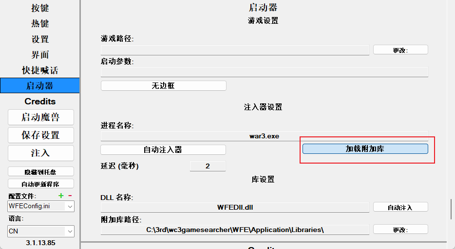
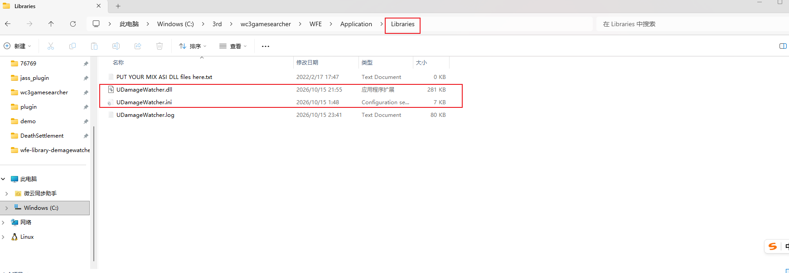

# UDamageWatcher · 魔兽争霸 III 伤害监视插件

> **把每一笔伤害摆到你眼前**：谁打的、什么类型、增伤前多少、实际掉血多少。
> 选中一个单位，它这一条命挨的每一刀都会被记账；倒下的那一刻，自动出一份完整战报。

```
来源 武装牛头姬 是否攻击:1 是否远程:1 攻击类型:5 伤害类型:4 伤害:11300.00 实际:46397.62
```

```
[统计] 星之真神(H02N) 死亡结算 238 次 / 7218236.5
  是否攻击:1 是否远程:1 攻击类型:5 伤害类型:4  96 次 1086000.00 2145300.40 (29.7%)
  是否攻击:0 是否远程:0 攻击类型:0 伤害类型:8  142 次 4168100.00 5072936.10 (70.3%)
  来自 武装牛头姬(H038) 次 96 1086000.00 2145300.40 (29.7%)
  来自 龙翼守卫(H039) 次 142 4168100.00 5072936.10 (70.3%)
```

## 能干什么

- **逐条伤害明细**：来源 + 是否攻击 / 是否远程 / 攻击类型 / 伤害类型 + 伤害值，实时上屏
- **增伤前 vs 增伤后**：`伤害` = 地图增伤前的原始值，`实际` = 增伤后真实掉血
- **选中即记账、死亡自动结算**：次数 / 总伤害 / 四维联合拆分 / 按来源单位占比
- **热键零聊天流量**：`Ctrl+Alt+…` 切模式；`@` 命令也会被拦下不广播给同局
- **零 JAPI 依赖**：有 `ydbase` 走 JAPI，没有就引擎直连 `game.dll` —— 单机 / 平台都能用
- **联机安全**：选区纯内存读，不建组、不分配句柄，不触发「数据不同步」
- **与 WFE 伤害数字共存**：链式挂钩，两边都能拿到同一笔伤害事件
- **记账精确**：嵌套伤害事件（攻击里套 DOT）逐层扣除不重复；尸体挨打不计

## 安装

前提是你已经在用 **WFE（Warcraft Feature Extender）**。

1. 勾选 WFE 启动器里的 **「加载附加库」**
2. 把 `UDamageWatcher.dll` 和 `UDamageWatcher.ini` 放进 WFE 的 `Libraries` 目录
3. 进游戏即可（开局默认静默，按热键开启）

卸载：删掉这两个文件即可。

## 快速上手

1. `Ctrl+Alt+1` —— 打开明细（显示自己和友军造成的伤害）
2. 鼠标点一个单位 → `Ctrl+Alt+R` —— 开始记录它
3. 它死时自动出结算；随时看按 `Ctrl+Alt+Q`

## 热键

| 热键 | 作用 |
|---|---|
| `Ctrl+Alt+0/1/2/3` | 只显示自己 / 自己+友军 / 敌人 / 关闭 |
| `Ctrl+Alt+R` | 记录当前选中的单位 |
| `Ctrl+Alt+Q` | 立刻打印当前统计 |
| `Ctrl+Alt+S` | 停止记录并结算 |
| `Ctrl+Alt+D` | 调试日志开关 |

## 环境

- 魔兽争霸 III **1.27.0.52240**（实机验证版本）
- **WFE**（Warcraft Feature Extender）
- Windows
- 杀毒软件可能会误杀，发生后请放行

## 边界

- 需要注入器（WFE）才能加载；只在 1.27.0.52240 上实机验证（换版本会自动安全退出，不影响游戏）
- 开局默认**静默**，必须手动开启（热键或 `@` 命令）
- 类型号一律显示**原始数字**；结算默认只统计 ≥5 点的伤害

## 文档

- [宣传文案.md](宣传文案.md) —— 完整介绍、效果示例、热键、配置、常见问题
- [伤害监视说明.md](伤害监视说明.md) —— 完整技术说明（挂接点、文本编码、选区内存布局、排错）

## 安装


